# Ejercicios 03: Sprites 2D
<sup> José Javier Ramos Carballo, [alu0101313313](https://github.com/alu0101313313)


## Indice

1. [Introducción](#1-introducción)
2. [Tareas a Realizar](#2-tareas-a-realizar)
3. [Desarrollo](#3-desarrollo)
4. [Conclusiones](#4-conclusiones)
5. [Bibliografía](#5-bibliografía)


## 1. Introducción
En esta práctica de la asignatura [Fundamentos del Desarrollo de Videojuegos](https://campusvirtual.ull.es/2627/doctoradoyposgrado/course/view.php?id=2627110295), nos encargaremos de realizar una serie de ejercicios relativos a como funciona el sistema de sprites en un proyecto 2D.

## 2. Tareas a Realizar

  1. [ ] Realizar los diferentes ejercicios marcados en la [hoja de ejercicios](https://docs.google.com/document/d/14T_HCzmx1xAshkD94H7dGztcy1F3adwIi1UPQeZu1VY/edit?tab=t.0)

## 3. Desarrollo

1. Agregar el atlas de sprites del personaje a la escena. Configurar el sprite como múltiple y subdividirlo para tener acceso a los sprites para generar las animaciones. Agregar una de las imágenes a la escena. 


2. Creamos un objeto 2D, arrastrando un conjunto de imágenes que selecciones al objeto añadiremos una animación. Agregar al personaje la animación “Walk Down” . Añadir otra imagen y generarle otra animación.  De esa forma Unity crea un objeto Animation, la primera vez que se crea, también añade un objeto Animator Controller.


A partir de este punto, todos los puntos del guión, requeiren de modificar el codigo poco a poco para implementar el movimiento horizontal del personaje, por lo que se colocara el codigo, y se comentara en este informe cada parte de este, lo cual referirá a los que se nos requiere en las siguientes entregas:

```C#

using UnityEngine;
using UnityEngine.InputSystem.Controls;
using UnityEngine.Rendering;

public class CharacterMovement : MonoBehaviour
{
  public float speed = 3f;
  
  private SpriteRenderer spriteRenderer;
  private Animator animator;

  
  // Start is called once before the first execution of Update after the MonoBehaviour is created
  void Start()
  {
    spriteRenderer = GetComponent<SpriteRenderer>();
    animator = GetComponent<Animator>();
  }

  // Update is called once per frame
  void Update()
  {
    float horizontalUpdate = Input.GetAxis("Horizontal");
    Vector2 movement = new Vector2(horizontalUpdate, 0);
    transform.Translate(movement * speed * Time.deltaTime);

    if(horizontalUpdate > 0)
    {
      spriteRenderer.flipX = false;
    } 
    else if (horizontalUpdate < 0)
    {
      spriteRenderer.flipX = true;
    }

    animator.SetBool("isWalking", horizontalUpdate != 0);
  }
}

```

Para empezar tenemos lo siguiente:

```C#
public float speed = 3f;

private SpriteRenderer spriteRenderer;
private Animator animator;
```

Un flotante que nos ayudara a indicar la velocidad del movimiento del personaje, la cual la hacemos publica para poder tocar desde el editor de Unity, antes y/o entre la ejecucción.

Mientras que de manera privada, encapsulamos un Animator y un SpriteRenderer, que respectivamente, se encargan de enlazar la animación que hemos realizado anteriormente al codigo de nuestro personaje; mientras que con el spriteRenderer podemos tener control del sprite del personaje, lo que nos va a permitir luego invertir la direccion al moverse a la derecha y/o izquierda en el mapa.

```C#
void Start()
{
  spriteRenderer = GetComponent<SpriteRenderer>();
  animator = GetComponent<Animator>();
}
```

Un metodo Start que nos permite obtener los componentes que hemos asignado para poder trabajar con el animator y el spriteRenderder del personaje.

```C#
void Update()
{
  float horizontalUpdate = Input.GetAxis("Horizontal");
  Vector2 movement = new Vector2(horizontalUpdate, 0);
  transform.Translate(movement * speed * Time.deltaTime);

  if(horizontalUpdate > 0)
  {
    spriteRenderer.flipX = false;
  } 
  else if (horizontalUpdate < 0)
  {
    spriteRenderer.flipX = true;
  }

  animator.SetBool("isWalking", horizontalUpdate != 0);
}
```

En el Update, queremos detectar con el sistema viejo, el movimiento "Horizontal", lo que nos automatiza las teclas correspondientes para el movimiento horizontal del personaje, de forma que con el movimiento asignado a un vector que solo mueve la dirección X, y fuerza la dirección Y a 0.

Luego con el _Translate()_ realizamos el movimiento normalizado con el _Time.DeltaTime_ y aqui participa el spriteRenderer, dado a que segun si detectamos un movimiento superior a 0, nos moveremos a la derecha, lo cual pide enderezar el sprite hacia su dirección natural, mientras que si detectamos un movimiento inferior a 0, nos moveremos a la izquierda, lo que requiere invertir el sprite hacia su dirección contraria.

La linea final se encarga de activar el flag de que el animator proceda a moverse al estado de _isWalking_ en el que se ve la animación de movimiento.

En la ejecucción se ve de esta forma
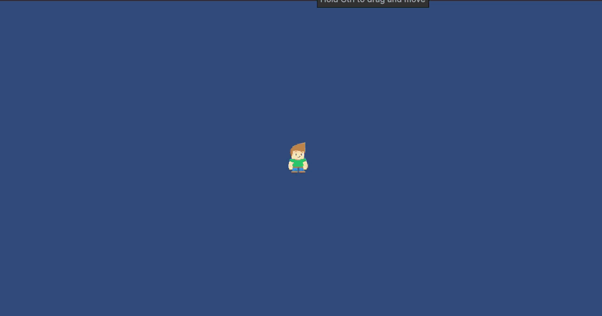

Ahora lo que tocamos seran los siguientes puntos:

 - Declarar una variable para ir actualizando en cada frame la distancia recorrida.
 - Una variable que le puedas dar el valor que quieras que active el cambio, si la variable distancia supera el valor, se tiene que pasar a otra animación
 - Obtener una referencia al Animator: Tienes que acceder al componente Animator sólo una vez para utilizarlo en el código. Debes obtener una referencia a él en tu script para poder controlar el cambio de una animación a otra.
 - En cada frame debes calcular cuánto se ha movido el personaje desde la posición inicial.
 - Si la distancia total recorrida supere la distancia de activación, tu script debe indicarle al Animator que reproduzca la nueva animación.
 - Calcular la distancia que hay entre la posición actual y la que anterior

Para empezar decidimos hacer una nueva animación para correr, lo que nos permitiria calcular la distancia recorrida, y cambiar de animación cuando el personaje recorra una cierta cantidad caminando.

Por ello, por un lado lo que hacemos una nueva animación arrastrando nuevos sprites al _Animation_, lo que nos permite generar una nueva animación en base al personaje con el que estamos trabajando.

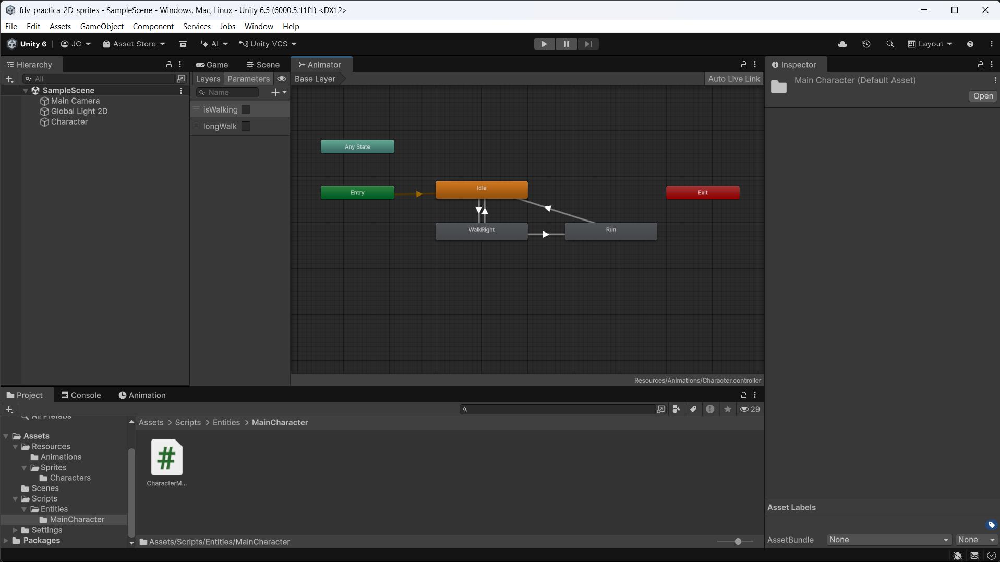

Como se puede ver en la imagen, se entiene que desde el estado **_"Idle"_**, tenemos al personaje quieto, mientras que si movemos el personaje a la izquierda o la derecha, transicionamos al estado **_"WalkRight"_**. Entonces la adicción de la animación de correr funciona de la siguiente manera: si nos mantenemos caminando en la misma dirección, tras recorrer una cierta distancia, transicionamos al estado **_"Run"_**, el cual incrementa la velocidad y obtiene una animación distinta, pero que si paramos volvermos al estado **_"Idle"_** volviendo al estado quieto.

Para poder lograr esto se ha modificado el codigo de la siguiente manera:

```C#
public class CharacterMovement : MonoBehaviour
{
  public float speed = 3f;
  public float runSpeed = 6f;
  public float activatedDistance = 5f;
  private SpriteRenderer spriteRenderer;
  private Animator animator;
  private Vector3 previousPosition;
  private float distanceTraveled = 0f;

  void Start()
  {
    spriteRenderer = GetComponent<SpriteRenderer>();
    animator = GetComponent<Animator>();
    previousPosition = transform.position;
  }

  void Update()
  {
    float horizontalUpdate = Input.GetAxis("Horizontal");
    Vector2 movement = new Vector2(horizontalUpdate, 0);

    bool isRunning = animator.GetCurrentAnimatorStateInfo(0).IsName("Run");
    float currentSpeed = isRunning ? runSpeed : speed;
    transform.Translate(movement * currentSpeed * Time.deltaTime);

    if(horizontalUpdate > 0)
    {
      spriteRenderer.flipX = false;
    } 
    else if (horizontalUpdate < 0)
    {
      spriteRenderer.flipX = true;
    }

    bool moving = horizontalUpdate != 0;
    animator.SetBool("isWalking", moving);

    float distanceThisFrame = Vector3.Distance(previousPosition, transform.position);
    previousPosition = transform.position;

    if (moving)
    {
      distanceTraveled += distanceThisFrame;
    }
    else
    {
      distanceTraveled = 0.0f;
    }
    
    animator.SetBool("longWalk", distanceTraveled > activatedDistance);
  }
}
```

En este nuevo codigo se han optado por añadir diferentes medidas:

- Un nuevo flotante que identifica la velocidad para la animación de correr.
- Un ternario que identique la velocidad del personaje en base si camina o corre
- Un calculo que permite definir la distancia recorrida en base a la posición inicial y la posición actual

Gracias a esta implementación actualmente el movimiento se ve asi:

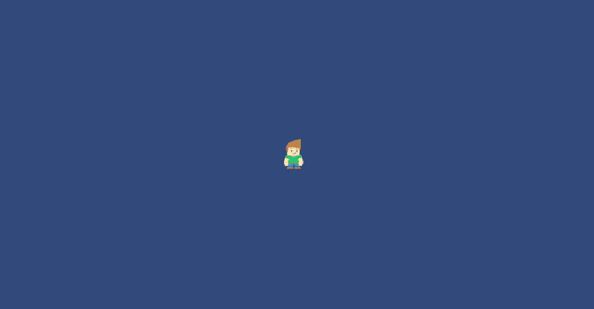

En este punto de la práctica, vamos a trabajar con el _PPU (Pixel per Unit)_. 

Una unidad de Unity es una celda de la cuadrícula de la vista Scene. El PPU (Pixels Per Unit) indica cuántos píxeles de la imagen caben en una unidad, y este se calcula de la siguiente manera:

```
unidades = píxeles de altura ÷ PPU
```

Este en Unity por defecto vale 100, y en base a este, nuestro personaje tiene unas medidas indicadas en la siguiente imagen, marcadas debajo de los valores de posición x e y.  
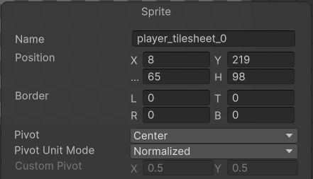

Si aplicamos la formula con una PPU = 100, conoceremos cuantas unidades ocupa nuestro sprite.

```
unidades = 98 ÷ 100 = 0.98 uds Unity
```

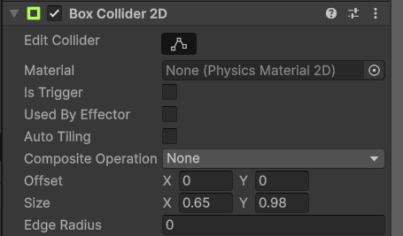

Este ejercicio nos pide dotarle de diferentes valores, concretamente con los valores 16, 32 y 100.

Tras comprobar las medidas con 100, cambiamos las medidas con PPU = 32 y PPU = 16 con los siguientes resultados
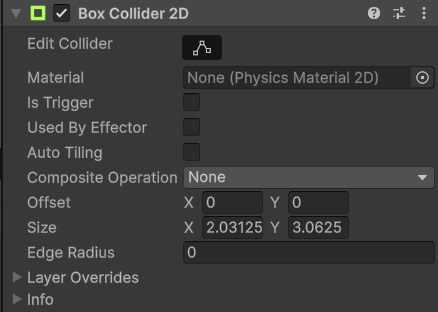
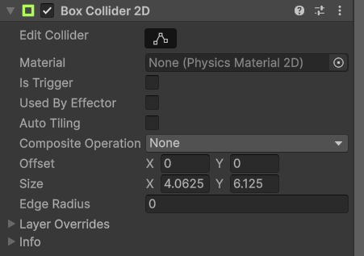

Como podemos ver, el tamaño es mayor a cuanto menor es el PPU, no obstante aqui lo que cambia no es el tamaño del sprite, lo que cambia es cuántas unidades ocupa en la escena. 

Ahora, se nos requiere ajustar el PPU para que nuestro personaje ocupe entre 1 o 2 unidades en la escena. Una aproximación para escoger un valor correcto, seria invertir la formula anterior:

```
PPU = alto en píxeles ÷ unidades deseadas
```

Dado a que con la medida anterior, si escogemos 1 ud, el PPU directamente es igual al alto en pixeles, en nuestro caso 98, mientras que si escogemos 2 uds, el PPU es la mitad del alot en pixeles, en este caso 49.

En mi caso escogere 98, dado a que al tener una altura inferior en pixeles, se ocupara menos de un pixel.

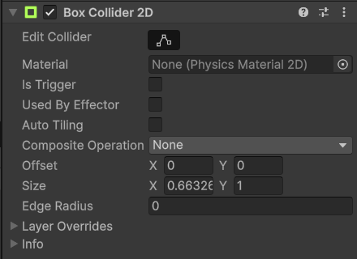

Ahora la prueba se realizara con otro tilemap. En este escogeremos otro recurso que nos vino, en el cual trataremos con un personaje similar al personaje escogido, y los ajustaremos a un PPU distinto al del personje ya tratado. En este caso hemos escogido uno de los PPU propuestos anteriormente: 32, lo que si añadimos un sprite en comparación con nuestro personaje jugable, tenemos la siguiente comparación:

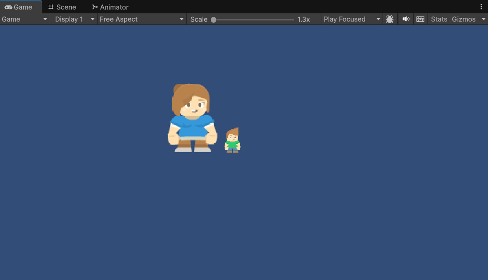.

Claramente, como ambos los tenemos en la misma escala y el PPU es distinto, la diferencia es claramente notoria, si aplicamos una escala al personaje no jugable de 0.36, tendriamos a ambos personajes que ocuparian 1 ud de Unity.

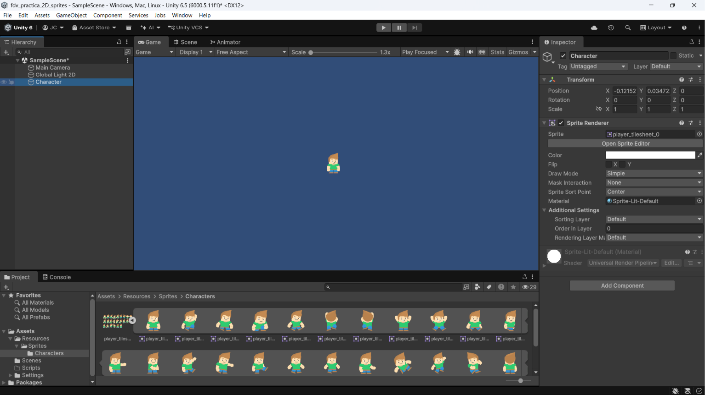

No obstante, por mucho que escalemos ambos personajes, el tamaño de los pixeles no es el mismo.
Un píxel de imagen ocupa Scale ÷ PPU unidades de escena:

Player (PPU 98, Scale 1): 1 ÷ 98 ≈ 0,0102 unidades por píxel.
Female (PPU 32, Scale 0,36): 0,36 ÷ 32 ≈ 0,01125 unidades por píxel.

En resumen, los pixeles de Female son un 10% mayores a los pixeles a los del player, lo cual visualmente provoca un desequilibrio visual que a la larga es erratico, dado a que uno requiere de mas pixeles para poder tener el mismo tamaño que el otro.

La solución para obtener una uniformidad con todos los sprites del juego se basan en que deben tener el mismo PPU.  
Así, un píxel de imagen ocupa siempre lo mismo en pantalla, aunque cambie el tamaño del personaje. Si necesitas un sprite más grande o más pequeño, cambia la imagen o la escala de forma coherente, no el PPU de un único sprite.

Finalmente con el ultimo ejercicio, trataremos de manejar la relacion de aspecto de la camara, con los personajes.

Para comenzar en la camara tenemos una configuración predeterminada para un proyecto 2D, en la que tenemos lo siguientes datos

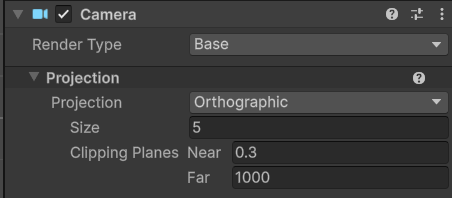

Concretamente nos centrarmeos en que la proyección es ortogonal y el tamaño es 5. Por un lado que la camara sea ortogonal, indica entre otras cosas que la relación que tiene para captar elementos en su lente es realtivo a esta formula.

```
Ud de Unity en vertical = 2 * Size
```

Si correspondemos con el tamaño 5, podemos ver que la camara ortografica graba hasta 10 ud de Unity en vertical (desde -5 a 5 de altura), los cuales podemos contar en la siguiente imagen:

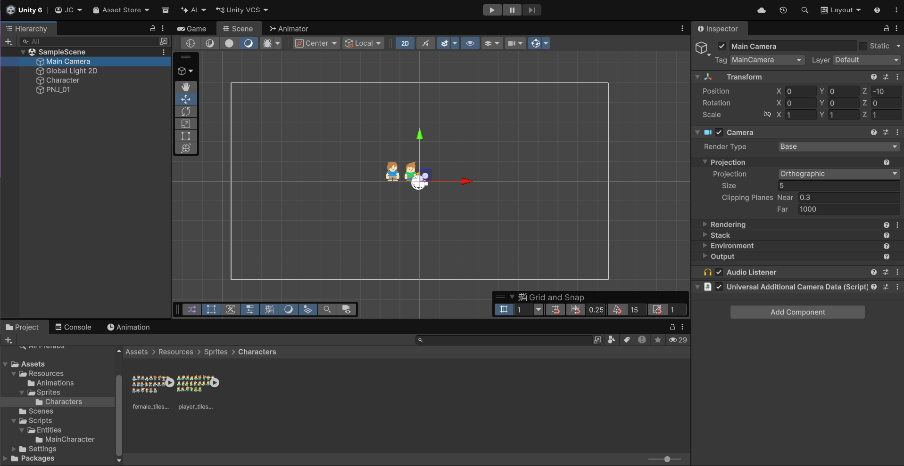

Precisamente si colocamos en los limites, estos entrarian cortados en la escena.

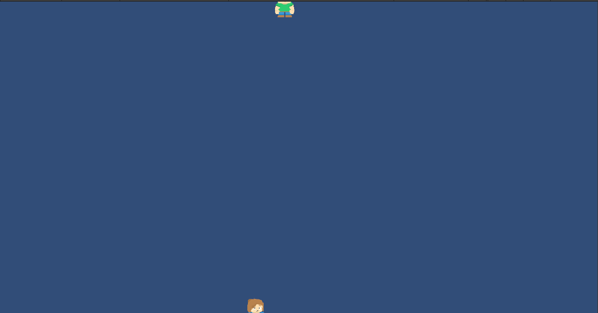

Ahora lo que tratamos es ver como se modifican nuestros personajes con diferentes resoluciones de pantalla como por ejemplo con una relación 16:9, 4:3, y de 2560x1080

- Resolución 16:9
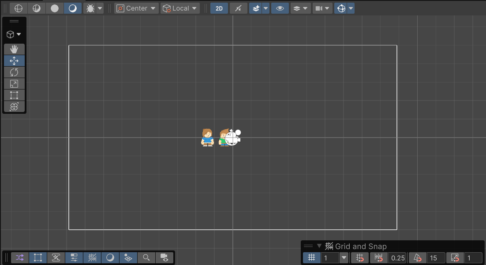

- Resolución 4:3
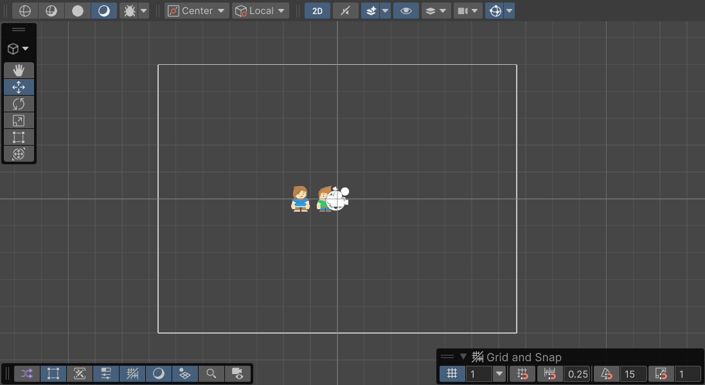

- Resolución 2560x1080
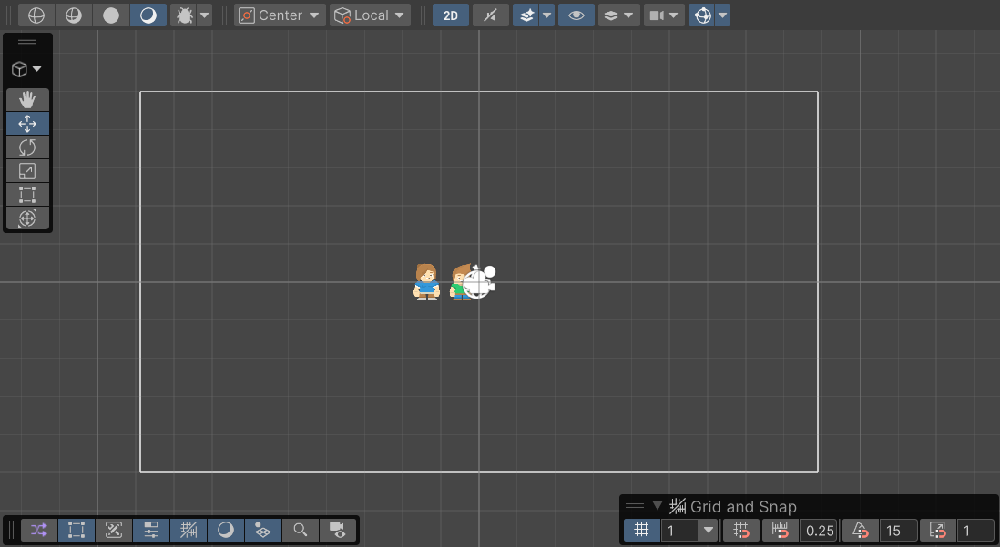

Como podemos apreciar, la relación de aspecto entre las 3 resoluciones no cambia en la altura, sino que difiere en las unidades de Unity que pilla la camara en el ancho, tal que cuando mas abarque la relación de aspecto, mas unidades de Unity pilla la camara en lo ancho.

Ahora tocaremos el tamaño que capta la camara. Por defecto tiene un tamaño 5, pero nos piden probar desde un tamaño 2 hacia un tamaño 10.

Al pasar de Size 2 a Size 10, el personaje se ve 5 veces más pequeño. Size funciona como un zoom: cuanto mayor es, más nivel cabe en pantalla. La prueba se encuentra en las siguientes imagenes:

- Size 2:
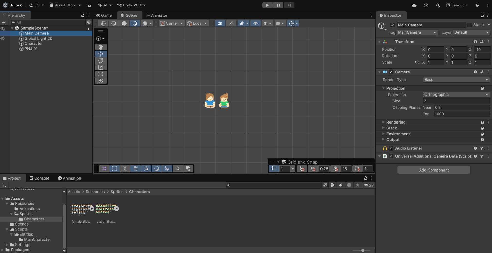

- Size 10:
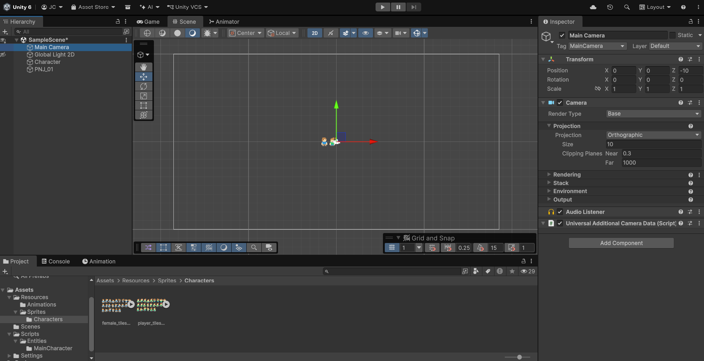

Ahora nos encargamos de mirar la anchura de la camara. Anteriormente, nos encargamos de ver con las relaciones de aspectos, que cantidad de unidades de Unity se captan a lo alto, mientras que ahora trataremos de conocer cuando recoge la camara en el ancho en diferentes resoluciones.

Si fijamos un tamaño 5 de la camara, las diferentes resoluciones indican que ancho es capaz de pillar la camara:

- Resolución 16:9


- Resolución 4:3


- Resolución 2560x1080


Si tenemos en cuenta la relación anterior de que con Size = 5, el valor que tenemos de unidades de Unity en altura es 10, El calculo lo podemos resovler con la siguiente formula:

```
altura * proporcion

16:9 -> 10 * 16 / 9 = 17,78 uds
4:3  -> 10 * 4 / 3  = 13,33 uds
2560 x 1080 -> 10 * 21 / 9 = 23,7 uds
```

Para terminar, tenemos que comprobar en que caso esto afecta a un videojuego multijugador. Es decir, si tuviesemos que comparar este videojuego con dos personas que lo jugasen con dos mmonitores distintos, que cambios habria.

No ven la misma cantidad de nivel. Ambos ven 10 unidades de alto, pero el jugador con el monitor más ancho ve más a izquierda y derecha.

Esto es un problema en juegos donde ver lo que viene es parte de la competición o de la jugabilidad, por ejemplo en un multijugador competitivo, un shooter 2D, un endless runner o un shmup. Un jugador con más anchura puede ver enemigos o peligros antes que el otro.

Para evitarlo, se puede fijar la anchura visible en lugar de la altura, o usar la proyección Hor+ de Unity, que mantiene la anchura constante en distintas pantallas.

## 4. Conclusiones
Gracias a esta práctica, podemos tener unas nociones esenciales como funciona un proyecto en 2D. Se ha tocado configuraciones como las animaciones y su forma de manejarlas con la maquina de estados, el trabajo con los tilemaps, y los diferentes recortados de sprites, las relaciones de aspecto de la camara y su influencia en como permite el visionado de un juego, el PPU y su relevancia para el calculo de pixeles, entre otras.

## 5. Bibliografía
1. **Enunciado de la práctica:** [https://campusvirtual.ull.es/2627/doctoradoyposgrado/mod/assign/view.php?id=23548](https://campusvirtual.ull.es/2627/doctoradoyposgrado/mod/assign/view.php?id=23548)

2. **Guión de la práctica:** [https://docs.google.com/document/d/14T_HCzmx1xAshkD94H7dGztcy1F3adwIi1UPQeZu1VY/edit?tab=t.0](https://docs.google.com/document/d/14T_HCzmx1xAshkD94H7dGztcy1F3adwIi1UPQeZu1VY/edit?tab=t.0)

2. **Transparencias Sprites 2D:** [https://docs.google.com/presentation/d/1ZEZmTA6Kf83pr9CtNvuMpc4Y6voRO2me_BPLSD_GpfI/edit?slide=id.p1#slide=id.p1](https://docs.google.com/presentation/d/1ZEZmTA6Kf83pr9CtNvuMpc4Y6voRO2me_BPLSD_GpfI/edit?slide=id.p1#slide=id.p1)

