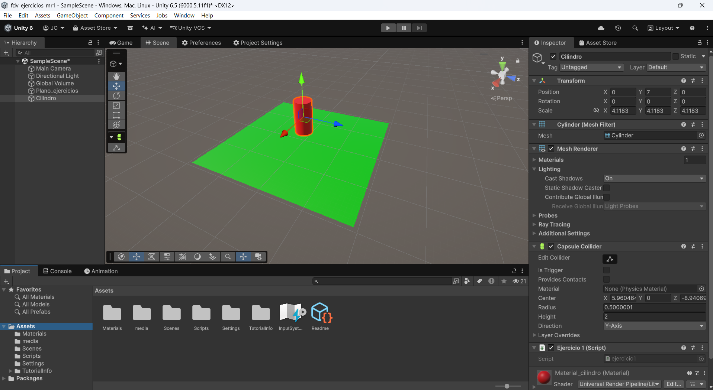
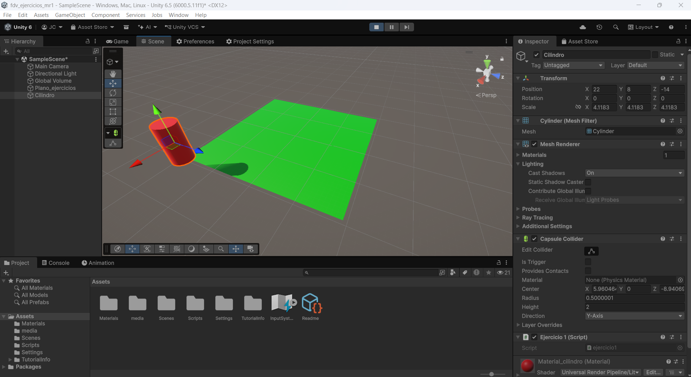
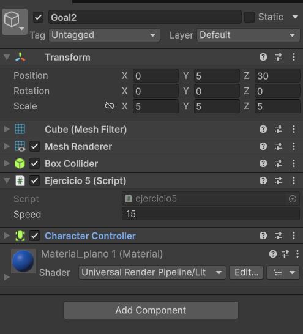

# Ejercicios 01: Movimiento Rectilíneo
<sup> José Javier Ramos Carballo, [alu0101313313](https://github.com/alu0101313313)


## Indice

1. [Introducción](#1-introducción)
2. [Tareas a Realizar](#2-tareas-a-realizar)
3. [Desarrollo](#3-desarrollo)
4. [Conclusiones](#4-conclusiones)
5. [Bibliografía](#5-bibliografía)


## 1. Introducción
En esta práctica de la asignatura [Fundamentos del Desarrollo de Videojuegos](https://campusvirtual.ull.es/2627/doctoradoyposgrado/course/view.php?id=2627110295), nos encargaremos de realizar una serie de ejercicios relativos a como funciona el movimiento rectilineo en los obejetos dentro del motor Unity

## 2. Tareas a Realizar

  1. [ ] Realizar los diferentes ejercicios marcados en la [hoja de ejercicios](https://docs.google.com/document/d/18_EWkMjJ2FBR3tfW_vu2qM16d7farPdCy09AC_LEeog/edit?tab=t.0)

## 3. Desarrollo

### Ejercicio 1

Para comenzar, realizaremos el primer ejericio que nos indica que debemos realizar un desplazamiento de un objeto 3D con la función **_Translate()_**.



Tras vincular el script con el cilindro, y insertando el siguiente codigo:

```C#
using UnityEngine;

public class ejercicio1 : MonoBehaviour
{
	public Vector3 GoalPosition = new Vector3(22, 1, -14);
	
	void Start()
	{
		this.transform.Translate(GoalPosition);
	}

	void Update()
	{
			
	}
}
```

> [!IMPORTANT]
> Fijese lo importante que es observar tanto la posición antes de ejecutar, y lo que se propone en _GoalPosition_.

Al ejecutar, podemos observar el siguiente comportamiento:



Es importante ver que el cilindro no se ha desplazado directamente a la posición que hemos indiciado en _GoalPosition_, sino que _this.transform.Translate(GoalPosition)_, ha sumado la posición inicial del cilindro mas la indicada, por que nos da como posición final, la posición indicada en la imagen.

Todo este comportamiento se indica en el enunciado, asi que lo que tenemos que comprobar son los diferentes apartados:

 1. Añadir this.transform.Translate(goal); al Update e ir multiplicando goal = goal * 0.5f; de esta forma darás saltos más pequeños cada vez. 
 2. ¿Qué sucede si pones la instrucción  goal = goal * 0.5f; en el Start?. 
 3. ¿Qué sucede si en el Update incluyes goal = goal * 2.0f;?

Al realizar estos cambios, podemos apreciar las siguientes diferencias:

 - Cuando añadimos la funcion _Translate()_ en el update, y actualizamos su valor se actualiza en cada frame, pero como en cada uno su alcance se divide en la mitad, este se mueve cada vez mas lento hasta que se queda quieto.

 - En este caso, lo que ocurre es que al recolocar la actualización en el start, se mantiene que solo se divide una vez la posición de conclusión, pero se sigue actualizando la posición cada frame, este movimiento se mantiene constante, provocando que con el siguiente codigo se resuelva de la siguiente manera:

 ```C#
using UnityEngine;

public class ejercicio1 : MonoBehaviour
{
	public Vector3 GoalPosition = new Vector3(22, 1, -14);
	
	void Start()
	{
		// Actualización movimiento
		GoalPosition = GoalPosition * 0.5f;
	}

	void Update()
	{
		this.transform.Translate(GoalPosition);
	}
}
 ```


 - Luego de volver a colocar la actualización de la posición en el _Update()_, junto a la función _Translate()_ cambiar la actualización para duplicar la posición final, pasa lo contrario al primer caso, donde este se mueve exponencialmente hasta llegar al limite del mapa.

Similar ocurre con las siguentes cuestiones que se nos plantean.

 - Configurar la coordenada Y del Objetivo en 0
 - Poner al objetivo la coordenada Y distinta de 0

En el segundo caso es lo que llevamos haciendo en todo momento, que como colocamos un valor distinto a 0 en la coordenada Y del objetivo, y cundo este ejecuta se eleva o desciende depende del signo de la posición objetivo.

En el primer caso, simplemente avanza hacia las coordenadas X e Z de la posición objetivo mantiendose en la coordenada Y de la posición principal del cilindro.


Como finalización de este primer ejercicio nos piden lo sigueinte:

 - Modificar el scrpit para que el objeto despegue del suelo y vuele como un avión.

Para ello, tenemos que añadir diferentes elementos en nuestro codigo. Por un lado nos encargamos de asegurarnos que este "despegue" hacia la dirección que calculamos, y a su vez, cuando llegue pare.

Para poder hacer que se pare en el momento, añadimos una _flag_ que se encargase de comprobarlo en base a la distancia que nos queda para alcanzar la posición objetivo.

Por otro lado recrear la sensación de que "despegue y vuele como un avion", medimos una rotación que orienta el cilindro hacia la dirección objetivo.

```C#
using UnityEngine;

public class ejercicio1 : MonoBehaviour
{
	public Vector3 GoalPosition = new Vector3(22, 10, -14); // posición objetivo 
	
	public float speed = 5f;                                // unidades por segundo
	public float rotationSpeed = 60f;                       // grados por segundo que puede girar el morro
	public float arrivalDistance = 0.2f;                    // distancia a la que se considera que ha llegado

	private bool arrived = false;                           // flag que indica si ha llegado al objetivo

	void Update()
	{
		// Calculamos la dirección y la distancia al objetivo
		Vector3 direccion = GoalPosition - transform.position;
		float distancia = direccion.magnitude;

		// Si ya está lo bastante cerca, se coloca exactamente en el objetivo y se detiene
		if (distancia <= arrivalDistance)
		{
			transform.position = GoalPosition;
			arrived = true;
			return;
		}

		// Gira poco a poco el morro hacia el objetivo.
		Quaternion rotacionObjetivo = Quaternion.LookRotation(direccion);
		transform.rotation = Quaternion.RotateTowards(transform.rotation, rotacionObjetivo, rotationSpeed * Time.deltaTime);

		// Avanza hacia el objetivo
		transform.Translate(Vector3.forward * speed * Time.deltaTime);
	}
}
```


### Ejercicio 2

1. Sustituir la dirección del movimiento por su equivalente normalizada. Esto se consigue con el método normalized de la clase Vector3: this.transform.Translate(goal.normalized);

	Volviendo al codigo principal

	```C#
	using UnityEngine;

	public class ejercicio2 : MonoBehaviour
	{
		public Vector3 GoalPosition = new Vector3(22, 10, -14); // posición objetivo

		void Update()
		{
			this.transform.Translate(GoalPosition * speed * Time.deltaTime);
		}
	}
	```

	La idea es normalizar el movimiento, esto significa que en cada frame el avance se realize de forma homogenea. 

	```C#
	using UnityEngine;

		public class ejercicio2 : MonoBehaviour
		{
		public Vector3 GoalPosition = new Vector3(22, 10, -14); // posición objetivo

		void Update()
		{
			this.transform.Translate(GoalPosition.normalized);
		}
	}
	```

2. Con el vector normalizado, lo podemos multiplicar por un valor de velocidad para determinar cómo de rápido va el personaje. public float speed = 0.1f this.transform.Translate(goal.normalized*speed)

	Aqui precisamente, lo que hacemos es contemplar un factor de escala que es la velocidad que decida lo rapido o lento que se mueve

	```C#
	using UnityEngine;

	public class ejercicio2 : MonoBehaviour
	{
		public Vector3 GoalPosition = new Vector3(22, 10, -14); // posición objetivo
		public floar speed = 0.1f;

		void Update()
		{
			this.transform.Translate(GoalPosition.normalized * speed);
		}
	}
	```

3. A pesar de que esas velocidades puedan parecer ahora que son consistentes, no lo son, porque dependen de la velocidad a la que se produzca el Update. El tiempo entre dos Updates del mismo objeto no es necesariamente siempre el mismo, con lo que se pueden tener inconsistencias en la velocidad, y a pesar de que en aplicaciones con poca complejidad no lo notemos, se debe usar: this.transform.Translate(goal.normalized * speed*Time.deltaTime); para suavizar el movimiento ya que Time.deltaTime es el tiempo que ha pasado desde el último frame.

	Lo equivalente en el codigo seria lo siguiente

	```C#
	using UnityEngine;

	public class ejercicio3 : MonoBehaviour
	{
		public Vector3 GoalPosition = new Vector3(22, 10, -14); // posición objetivo
		public floar speed = 0.1f;

		void Update()
		{
			this.transform.Translate(GoalPosition.normalized * speed * Time.deltaTime);
		}
	}
	```
	Esto lo que nos permite es tener un movimiento como el siguiente

	

### Ejercicio 3

1. Hacemos el objetivo una variable pública public Transform goal y añadimos un public float speed = 1.0f.  

	En este apartado pillamos el movimiento que ya habiamos realizado tanto que dependiese de que fuese uniforme, y que tuviese la posición objetivo y la velocidad como variables publicas para poder manejar desde el propio motor de Unity.
	
	```C#
	using UnityEngine;

	public class ejercicio3 : MonoBehaviour
	{
		public Transform GoalPosition  // posición objetivo
		public floar speed = 1.0f;

		void Update()
		{
			this.transform.Translate(GoalPosition.normalized * speed * Time.deltaTime);
		}
	}
	```

2. Giramos al personaje para lograr que su movimiento sea hacia delante utilizando this.transform.LookAt(goal.position) en el Start para que gire primero y luego se mueva. 

	Modificamos el codigo que tenemos para tratar de rotar nuestro cilindro, hacia la dirección de la posición objetivo 

	```C#
	using UnityEngine;

	public class ejercicio3 : MonoBehaviour
	{
		public Transform GoalPosition // posición objetivo
		public floar speed = 0.1f;

		void Start()
		{
			// Orienta el objeto hacia la posición objetivo al inicio
			this.transform.LookAt(GoalPosition);
		}

		void Update()
		{
			this.transform.Translate(GoalPosition.normalized * speed * Time.deltaTime);
		}
	}
	```

3. La dirección en la que nos tenemos que mover viene determinada por la diferencia entre la posición del objetivo y nuestra posición:
 Vector3 direction = goal.position - this.transform.position;
this.transform.Translate(direction.normalized * speed * Time.deltaTime)
 
	Modificamos el codigo que tenemos, para tratar de rotar nuestro cilindro, hacia la dirección de la posición objetivo. 

	```C#
	using UnityEngine;

	public class ejercicio3 : MonoBehaviour
	{
		public Transform GoalPosition;   // posición objetivo
		public float speed = 1.0f;       // unidades por segundo
		
		void Start()
		{
			// Orienta el objeto hacia la posición objetivo al inicio
			this.transform.LookAt(GoalPosition.position);
		}

		void Update()
		{
			// Si ya ha llegado, no hace nada
			if (arrived) return; 
			
			// Calcula la dirección hacia el objetivo
			Vector3 direction = GoalPosition.position - transform.position;
			
			// Mueve el objeto hacia la posición objetivo
			this.transform.Translate(direction.normalized * speed * Time.deltaTime);
		}
	}
	```

	

	Si lo ejecutamos en este momento, como la orientación del personaje va a cambiar, el translate no va a funcionar correctamente, el vector direction se ha calculado con el sistema de referencia alineado con el mundo. Al rotar al personaje cambiamos ese sistema de referencia, por tanto, habrá que hacer el cambio a la dirección. Los ejes del personaje y el mundo no están alineados. El movimiento se debe hacer de forma relativa al sistema de referencia del mundo.

	```C#
	// Mueve el objeto con respecto al mundo hacia la posición objetivo
	this.transform.Translate(direction.normalized * speed * Time.deltaTime, Space.World);
	```

	


### Ejercicio 4

1. Añadir Debug.DrawRay(this.transform.position,direction,Color.red) para depuración para comprobar que la dirección está correctamente calculada

	```C#
	// Dibuja un rayo rojo desde la posición del objeto hacia la dirección del objetivo 
	Debug.DrawRay(this.transform.position, direction, Color.red);
	```

### Ejercicio 5

1. Agregar un cubo en la escena que hará de objetivo, que debe ser movido por teclado, con las teclas de flechas. Sobre la escena que has trabajado ubica un personaje que va a seguir al cubo. 

	

2. Crear un script que haga que el personaje siga al cubo continuamente sin aplicar simulación física.

	Con el movimiento asignado que teniamos en los ejercicios anteriores, aproveche de añadir como posición objetivo este nuevo cubo, y entre los elementos del cilindro para acceder, añadi como posición objetivo el transform del cubo, lo que nos permite el comportamiento que se ve en el gif anterior.

3. Agregar un campo público que permita graduar la velocidad del movimiento desde el inspector de objetos.

	

4. Utilizar la tecla de espaciado para incrementar la velocidad del desplazamiento en el tiempo de juego.

	```C#
	float space = Input.GetKey(KeyCode.Space) ? 1f : 0f;

	if(space > 0f) speed++;
	```

### Ejercicio 6

1. Realizar un script que gire al personaje hacia su objetivo para llegar hasta él desplazándose sobre su vector forward local.

	

### Ejercicio 7

1. Controlar el jittering utilizando la magnitud de la dirección.

	```C#
	using UnityEngine;

	public class ejercicio7 : MonoBehaviour
	{
		public Transform GoalPosition;
		public float speed = 1.0f;
		public float accuracy = 0.01f;

		void Update()
		{
			Vector3 direction = GoalPosition.position - this.transform.position;

			if(direction.magnitude > accuracy)
			{
				this.transform.LookAt(GoalPosition.position);
				this.transform.Translate(Vector3.forward * speed * Time.deltaTime);
			}
		}
	}
	```

2. Dado que la dirección nos la da la separación entre el objetivo y el personaje, también podemos controlar el jittering utilizando la distancia entre los dos puntos.

	```C#
	using UnityEngine;

	public class ejercicio7 : MonoBehaviour
	{
		public Transform GoalPosition;
		public float speed = 1.0f;
		public float accuracy = 0.01f;

		void Update()
		{
			Vector3 direction = GoalPosition.position - this.transform.position;

			if((Vector3.Distance(this.transform.position, GoalPosition.position)) > accuracy)
			{
				this.transform.LookAt(GoalPosition.position);
				this.transform.Translate(Vector3.forward * speed * Time.deltaTime);
			}
		}
	}
	```

3. Usar MoveTowards, que no se pasa nunca: si el paso es mayor que lo que falta, deja el objeto justo en el destino. 

	```C#
	using UnityEngine;

	public class ejercicio7 : MonoBehaviour
	{
		public Transform GoalPosition;
		public float speed = 1.0f;
		public float accuracy = 0.01f;

		void Update()
		{
			Vector3 direction = GoalPosition.position - this.transform.position;

			if((Vector3.Distance(this.transform.position, GoalPosition.position)) > accuracy)
			{
				this.transform.LookAt(GoalPosition.position);
				;
			}
		}
	}
	```

	

### Ejercicio 8

1. En este ejercicio se trabaja el Movimiento rectilíneo haciendo avanzar al personaje siempre en línea recta hacia adelante introduciendo una mejora. El uso de la función LookAt hace que el personaje gire instantáneamente hacia el objetivo, provocando cambios bruscos.

	


## 4. Conclusiones
Gracias a esta práctica, podemos tener unas nociones esenciales de como tener trabajar el movimiento rectilineo.

## 5. Bibliografía
1. **Enunciado de la práctica:** [https://campusvirtual.ull.es/2627/doctoradoyposgrado/mod/assign/view.php?id=23525](https://campusvirtual.ull.es/2627/doctoradoyposgrado/mod/assign/view.php?id=23525)

2. **Guión de la práctica:** [https://docs.google.com/document/d/18_EWkMjJ2FBR3tfW_vu2qM16d7farPdCy09AC_LEeog/edit?tab=t.0](https://docs.google.com/document/d/18_EWkMjJ2FBR3tfW_vu2qM16d7farPdCy09AC_LEeog/edit?tab=t.0)

