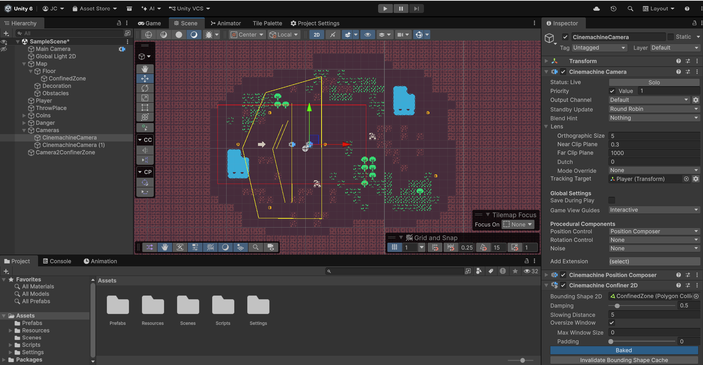
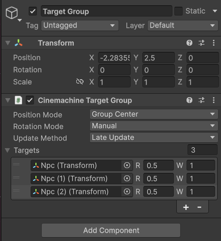

# Ejercicios 05: Cámara 2D
<sup> José Javier Ramos Carballo, [alu0101313313](https://github.com/alu0101313313)


## Indice

1. [Introducción](#1-introducción)
2. [Tareas a Realizar](#2-tareas-a-realizar)
3. [Desarrollo](#3-desarrollo)
4. [Conclusiones](#4-conclusiones)
5. [Bibliografía](#5-bibliografía)


## 1. Introducción
En esta práctica de la asignatura [Fundamentos del Desarrollo de Videojuegos](https://campusvirtual.ull.es/2627/doctoradoyposgrado/course/view.php?id=2627110295), nos encargaremos de realizar una serie de ejercicios relativos a como funciona el módulo de Cinemachine, para controlar las diferentes maneras de manejar la cámara en un videojuego.

## 2. Tareas a Realizar

  1. [ ] Realizar los diferentes ejercicios marcados en la [hoja de ejercicios]()

## 3. Desarrollo

Para empezar con esta práctica, nos debemos instalar la herramienta de _Cinemachine_, la cual nos brindara el funcionamiento de los ejercicios que queremos ejecutar. Para ello accedemos al package manager de Unity y buscamos el paquete de _Cinemachine_. 


Tras instalarlo, podemos buscarlo en el editor de Unity de la siguiente forma.


A partir de aqui comenzaremos a realizar los ejercicios de la práctica. 

> [!IMPORTANT]
> Cinemachine funciona como una herramienta que no añade cámaras que graban, sino que añade un módulo llamado _Cinemachine Brain_ que maneja diferentes perspectivas en base a un sistema de prioridades, tal que la que tiene prioridad mas alta, es la que se muestra en la pantalla de juego.

Comenzamos configurando 2 cámaras y trabajar con los diferentes parametros: DeadZone, Damping, Tracking Target. Se encargan de monitorizar a nuestro personaje, y ver la diferentes zonas de la cámara de forma que por un lado esta el _DeadZone_ (la zona central sin filtro y la zona azul), la cual permite tener un margen para el centrado de la cámara en el personaje; por otro lado tenemos el _Dampling_ que indica como de rigida es la cámara para moverse hacia el personaje; y luego el _HardLimits_ (la zona marcada en rojo) que es el limite duro que fuerza a que la cámara no se escape de los limites para que la cámara se reposicione.

En el siguiente video, podemos ver como probamos con 2 cámaras con estos parametros ajustados de diferente manera para ver estos comportamientos en detalle.


> [!NOTE]
> En versiones anteriores del paquete, la zona visible en azul se conoce como _Softzone_, y funciona como una medida que puedes manejar a parte de la zona libre de movimiento.

Luego empezamos a trabajar con zonas confinadas. 




Estas se definien por un módulo de _Cinemachine_ que nos permite que la cámara se limite por los limites de un Collider (en este caso utilizamos un polygonal collider 2D), y definimos cada parte en zonas separadas, para poder ver el movimiento dentro y fuera de estas, ademas de movernos entre ambas cámaras.


Luego sobre esto añadimos los target group. Su funcionamiento se basa en pivotar un tamaño que pueda enfocar a todos los elementos de un grupo para que se mantengan en la visión de la cámara.



En este primer ejemplo, podemos ver como con diferentes velocidades la cámara va movimendose para tenerlos todos dentro de su alcance.


No obstante, lo que también se puede modificar es el peso que le da la cámara para enfocar a uno de los integrantes del grupo. Concretamente con el segundo ejemplo podemos ver como pivotamos en que la cámara se cente mas o menos en alguno de los personajes tal que cuanto mas peso tengan, mas enfoque tendran por parte de la cámara.


Otra propiedad con la que trabajamos son los impulsos. En esto, podemos meter diferentes efectos a la cámara como sacudidas, lo cual lo probamos para este ejercicio.

Con la propiedad de _Cinemachine Impulse Source_ y la _Cinemachine Input Listener_, tenemos un elemento que genera la sacudida y un elemento oyente insertado en la cámara que cuando lo escuche genera la sacudida.

```C#
using UnityEngine;
using Unity.Cinemachine;
using System;

public class ExplosionTrigger : MonoBehaviour
{
  [SerializeField] private CinemachineImpulseSource impulseSource;

  // Update is called once per frame
  void Update()
  {
    if (Input.GetKey(KeyCode.Space))
    {
      impulseSource.GenerateImpulse();
    }
  }
}
```

El código es sencillo, ya que se encarga de que con el botón **SPACE** del teclado se genere la sacudida, provocando el siguiente efecto


Dado que configuramos elementos con inputs de teclado, otro ejercicio se encarga de hacer un módulo que al añadir en un objeto vacío con objetivo la cámara, podemos pulsar las teclas **"W"** y **"S"** para aumentar o disminuir el zoom respectivamente.


En este ejercicio, comenzamos a manejar las cámaras de forma independiente con las zonas confinadas anteriormente tratadas, pero en este caso tanto por un input como por una propia interfaz, podemos pivotar en que cámara se pone con mayor prioridad.


Con esta tarea, lo que tratamos es en añadir elementos que la camara funcione con _SlowMotion_ o _FastMotion_, tal que al pasar por una zona designada en el mapa que tenga ese comportamiento la camara acompañe ese efecto con un "zoom" hacia el personaje para dar el efecto tanto de lentitud como de rapidez en cada caso.


Para finalizar, lo que se trato fue de hacer una transición de las cámaras, de forma que una camara la tenemos confinada como en tareas anteriores, y luego tras pasar por una zona designada se transicione a otra cámara que permita un movimiento libre.


## 4. Conclusiones
Gracias a esta práctica, podemos tener unas nociones esenciales del paquete _Cinemachine_, el cual nos permite manejar de diferentes maneras, algunas propiedades como el del zoom, las sacudidas y las zonas confinadas, y el trato de manjear efectos como el slowMotion y/o fastMotion, y las transiciones tanto por prioridad, como por interfaz, o como por transición de zona confinada a camara libre como vimos en el ultimo ejercicio.

## 5. Bibliografía
1. **Enunciado de la práctica:** [https://campusvirtual.ull.es/2627/doctoradoyposgrado/mod/assign/view.php?id=23550](https://campusvirtual.ull.es/2627/doctoradoyposgrado/mod/assign/view.php?id=23550)

2. **Guión de la práctica:** [https://docs.google.com/document/d/1_k8HQSuFHssLJGwjbxhPbraSxhBTsiirJMexNPR46iY/edit?tab=t.0](https://docs.google.com/document/d/1_k8HQSuFHssLJGwjbxhPbraSxhBTsiirJMexNPR46iY/edit?tab=t.0)

3. **Transparencias cámaras** [https://docs.google.com/presentation/d/1azJDarxtjDX5vStki57ID8ez0bNVl9W6KFn2mlkrcqM/edit?slide=id.p1#slide=id.p1](https://docs.google.com/presentation/d/1azJDarxtjDX5vStki57ID8ez0bNVl9W6KFn2mlkrcqM/edit?slide=id.p1#slide=id.p1)

4. **Grabación Clase cámaras** [https://drive.google.com/file/d/1m33wkP6F9kvDLAJVMHxZZa7wkh-Njdz_/view](https://drive.google.com/file/d/1m33wkP6F9kvDLAJVMHxZZa7wkh-Njdz_/view)


