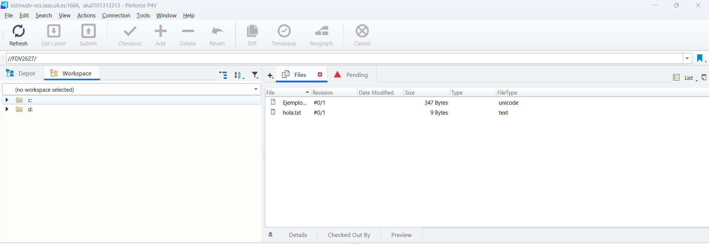
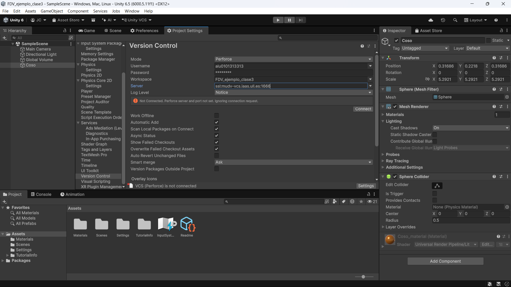
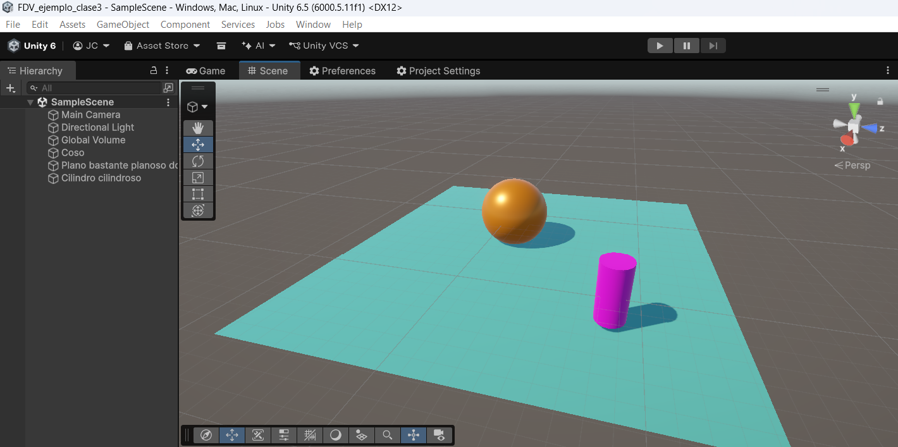
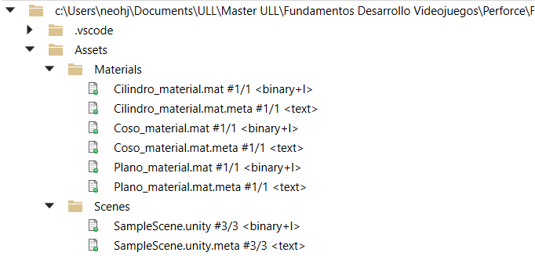

# Actividad 02: Herramienta Perforce
 José Javier Ramos Carballo, [alu0101313313](https://github.com/alu0101313313)

## Indice

1. [Introducción](#1-introducción)
2. [Tareas a Realizar](#2-tareas-a-realizar)
3. [Desarrollo](#3-desarrollo)
4. [Conclusiones](#4-conclusiones)
5. [Bibliografía](#5-bibliografía)

## 1. Introducción
En esta actividad de la asignatura [Fundamentos del Desarrollo de Videojuegos](https://campusvirtual.ull.es/2627/doctoradoyposgrado/course/view.php?id=2627110295), nos encargaremos de trabajar con la herramienta **_Perforce_**., la cual nos permite hacer control de versiones de nuestros proyectos.

## 2. Tareas a Realizar

  - [ ] Crear una conexión al deposito FDV2627
  - [ ] Crear un workspace para un proyecto Unity. Agrega tu proyecto como una carpeta en el depot con tu nombre de prefijo.
  - [ ] Modifica el proyecto agregando un objeto con un nuevo material. Actualiza el depot

## 3. Desarrollo

Para poder acceder a esta herramienta, debemos descargar la aplicación P4V, lo cual nos permite trabajar para la herramienta **_Perforce_**. Además de incluir que administrar la vpn de la ULL para poder acceder correctamente al depot donde trabajaremos.

> [!WARNING]    
> En mi caso particular, dado a que tenia que trabajar en el portatil, tendria que tener la VPN funcional, pero como toda la practica la pude resolver en la clase, no hubo problema.

Con ello, comenzamos con la práctica. Para comenzar, configuramos el servidor y nuestro acceso con la herramienta para acceder al depot de la práctica.

Para ello, creamos un nuevo workspace y ajustamos la ruta para enlazar correctamente el repositorio local con el workspace en el depot de la asignatura.

Para probar que esta conexion se habia realizado correctamente, probamos a subir dos ficheros significativos, y mas adelante un fichero **.p4ignore** que restringuiera los ficheros que se mantienen para control de versiones.

> [!NOTE]  
> El fichero **.p4ignore**, es equivalente a **.gitignore** en **_Perforce_**., ya que en ambos se escribe lo que se queda fuera de subir al workspace en la nube. 

Con estos ficheros insertados en el mismo programa, nos encargamos de seleccionar los ficheros que queremos subir al workspace en la nube, y los añadimos con la pestaña **Add** en la interfaz superior de **_Perforce_**.

Junto a ello, les añadiremos un ligero mensaje que indique la razón de subir dichos ficheros, y en la pestaña **Pending**, podemos ver estas selecciones de ficheros marcados para subir, con la intención de elegir que selecciones se suben a nuestro workspace.

- [x] Crear una conexión al deposito FDV2627

Desde este punto, que hemos realizado un correcto funcionamiento con unos pequeños ficheros, la idea es trabajar con proyectos de Unity. 

Creamos un proyecto de Unity al cual le extraemos sus carpetas esenciales para el control de versiones: 

- Assets
- Packages
- ProjectSettings

Estas las dirigimos hacia el directorio local que hemos indicado para **_Perforce_**, con la intención de generar un nuevo proyecto de Unity en este directorio.

Si realizamos los pasos anteriores al igual que hicimos con la subida de los archivos de prueba y el **.p4ignore**, nos quedaria un workspace de la siguiente manera:

.

- [x] Crear un workspace para un proyecto Unity. Agrega tu proyecto como una carpeta en el depot con tu nombre de prefijo.

A partir de aqui, lo que haremos sera de acondicionar el proyecto de Unity para poder integrar el control de versiones con nuestro workspace.

Para ello accederemos a Unity, y desde la configuración del proyecto, escogeremos **_Perforce_** como programa de control de versiones y incluiremos los datos requeridos para obtener el funcionamiento correcto.

Tras este paso, se ha implementado que los nuevos cambios en el proyecto para que el propio motor de Unity, los notifique y pueda realizar el proceso de subir los cambios al workspace en la nube directamente.

Para ellos probamos a crear nuevos objetos y materiales en el proyectos,de forma que tuvimos una distribución de la siguiente forma:

.

Para esta escena nos encargamos de añadir uno de los materiales de la escena, por tanto desde Unity, lo que ocurrio es que en la parte superior del objeto, nos salio este recuadro que nos preguntaba si dicho elemento se añadiria a una nueva selección en las selecciones que añadir al workspace en la nube.

.

Al realizar los pasos desde Unity, podemos tambien hacer esta nueva selección con el material nuevo.

Si la configuración se ha realizado correctamente, lo que nos ocurría es que en el workspace en la nube del depot de la asignatura, podemos ver como habremos subido una versión del proyecto actualizando los ultimos elementos subidos.

- [x] Modifica el proyecto agregando un objeto con un nuevo material. Actualiza el depot

## 4. Conclusiones
Gracias a esta práctica, podemos tener unas nociones esenciales de como utlizar la herramienta **_Perforce_**. lo cual tambien es una alternativa a **_Github_** para mantener un control de versiones,dado que este primero tiene integración directa con el motor.

## 5. Bibliografía
1. **Enunciado de la práctica:** [https://campusvirtual.ull.es/2627/doctoradoyposgrado/mod/assign/view.php?id=23508](https://campusvirtual.ull.es/2627/doctoradoyposgrado/mod/assign/view.php?id=23508)

2. **Guión de la práctica:** [https://docs.google.com/document/d/187iUuGObua5tJGysj6BL3r6wwHvf_MynjcEtZQ7Swts/edit?tab=t.0](https://docs.google.com/document/d/187iUuGObua5tJGysj6BL3r6wwHvf_MynjcEtZQ7Swts/edit?tab=t.0)
