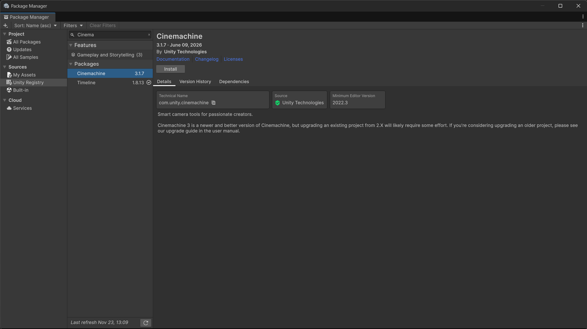
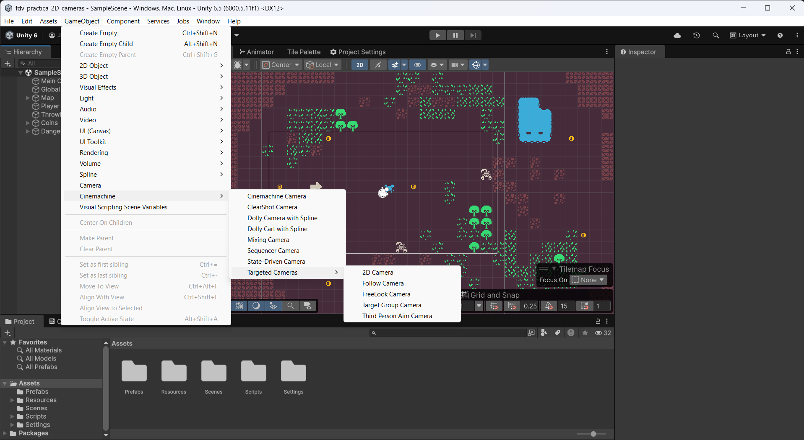
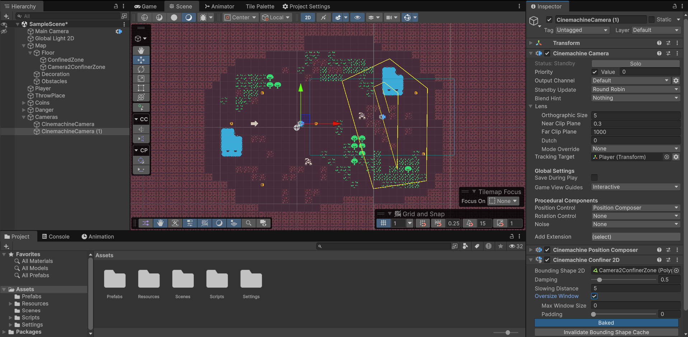

# Ejercicios 05: Cámara 2D
 José Javier Ramos Carballo, [alu0101313313](https://github.com/alu0101313313)

## Indice

1. [Introducción](#1-introducción)
2. [Tareas a Realizar](#2-tareas-a-realizar)
3. [Desarrollo](#3-desarrollo)
4. [Conclusiones](#4-conclusiones)
5. [Bibliografía](#5-bibliografía)

## 1. Introducción
En esta práctica de la asignatura [Fundamentos del Desarrollo de Videojuegos](https://campusvirtual.ull.es/2627/doctoradoyposgrado/course/view.php?id=2627110295), nos encargaremos de realizar una serie de ejercicios relativos a como funciona el modulo de Cinemachine, para controlar las diferentes maneras de manejar la camara en un videojuego.

## 2. Tareas a Realizar

  1. [ ] Realizar los diferentes ejercicios marcados en la [hoja de ejercicios]()

## 3. Desarrollo

## 4. Conclusiones
Gracias a esta práctica, podemos tener unas nociones esenciales de 

## 5. Bibliografía
1. **Enunciado de la práctica:** [https://campusvirtual.ull.es/2627/doctoradoyposgrado/mod/assign/view.php?id=23550](https://campusvirtual.ull.es/2627/doctoradoyposgrado/mod/assign/view.php?id=23550)

2. **Guión de la práctica:** [https://docs.google.com/document/d/1_k8HQSuFHssLJGwjbxhPbraSxhBTsiirJMexNPR46iY/edit?tab=t.0](https://docs.google.com/document/d/1_k8HQSuFHssLJGwjbxhPbraSxhBTsiirJMexNPR46iY/edit?tab=t.0)

3. **Transparencias Camaras** [https://docs.google.com/presentation/d/1azJDarxtjDX5vStki57ID8ez0bNVl9W6KFn2mlkrcqM/edit?slide=id.p1#slide=id.p1](https://docs.google.com/presentation/d/1azJDarxtjDX5vStki57ID8ez0bNVl9W6KFn2mlkrcqM/edit?slide=id.p1#slide=id.p1)

4. **Grabación Clase Camaras** [https://drive.google.com/file/d/1m33wkP6F9kvDLAJVMHxZZa7wkh-Njdz_/view](https://drive.google.com/file/d/1m33wkP6F9kvDLAJVMHxZZa7wkh-Njdz_/view)

