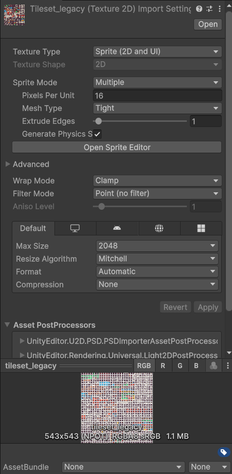
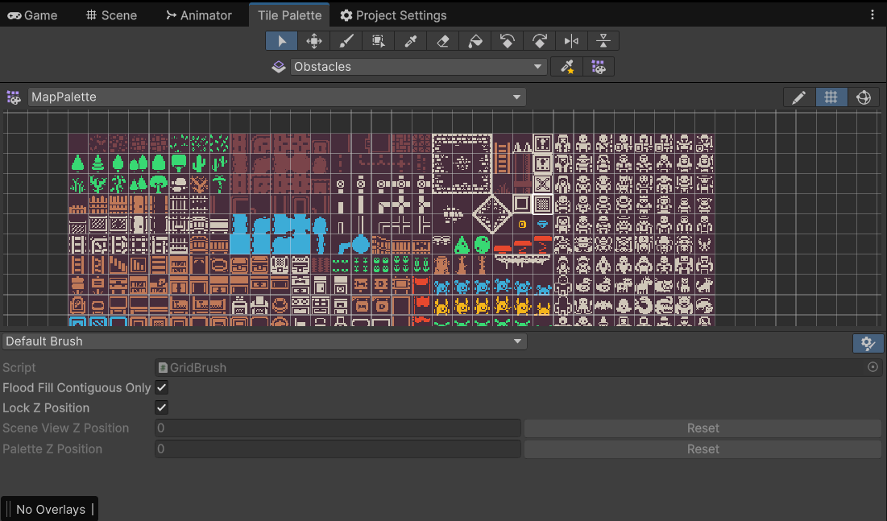
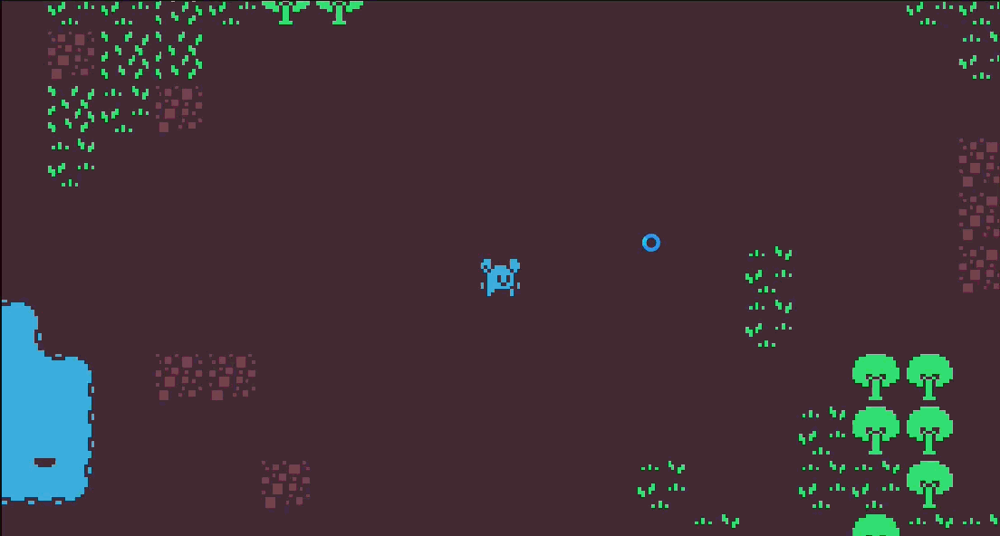

# Ejercicios 04: Mapas y Físicas 
<sup> José Javier Ramos Carballo, [alu0101313313](https://github.com/alu0101313313)


## Indice

1. [Introducción](#1-introducción)
2. [Tareas a Realizar](#2-tareas-a-realizar)
3. [Desarrollo](#3-desarrollo)
4. [Conclusiones](#4-conclusiones)
5. [Bibliografía](#5-bibliografía)


## 1. Introducción
En esta práctica de la asignatura [Fundamentos del Desarrollo de Videojuegos](https://campusvirtual.ull.es/2627/doctoradoyposgrado/course/view.php?id=2627110295), nos encargaremos de realizar una serie de ejercicios relativos a como funciona

## 2. Tareas a Realizar

  1. [ ] Realizar los diferentes ejercicios marcados en la [hoja de ejercicios]()

## 3. Desarrollo







```C#
using UnityEngine;

public class PlayerMovement : MonoBehaviour
{
	public float speed = 5f;
	private SpriteRenderer spriteRenderer;

	// Start is called once before the first execution of Update after the MonoBehaviour is created
	void Start()
	{
		spriteRenderer = GetComponent<SpriteRenderer>();
	}

	// Update is called once per frame
	void Update()
	{
		float horizontalUpdate = Input.GetAxis("Horizontal");
		float verticalUpdate = Input.GetAxis("Vertical");

		Vector3 direction = new Vector3(horizontalUpdate, verticalUpdate, 0f).normalized;
		transform.Translate(direction * speed * Time.deltaTime, Space.World);
	
		if (horizontalUpdate < 0) spriteRenderer.flipX = true;
		else if (horizontalUpdate > 0) spriteRenderer.flipX = false;
	}
}
```


```C#
using System;
using UnityEngine;

public class CameraFollow : MonoBehaviour
{
  public Transform target;
  private float smoothSpeed = 5f;
  private Vector3 offset = new Vector3(0f, 0f, -10f);

  // Update is called once per frame
  void LateUpdate()
  {
    if (target == null) return;

    Vector3 wishedPosition = target.position + offset;

    float factor = Mathf.Clamp01(smoothSpeed * Time.deltaTime);
    transform.position = Vector3.Lerp(transform.position, wishedPosition, factor);
  }
}
```





## 4. Conclusiones
Gracias a esta práctica, podemos tener unas nociones esenciales de como 

## 5. Bibliografía
1. **Enunciado de la práctica:** [https://campusvirtual.ull.es/2627/doctoradoyposgrado/mod/assign/view.php?id=23525]()

2. **Guión de la práctica:** [https://docs.google.com/document/d/18_EWkMjJ2FBR3tfW_vu2qM16d7farPdCy09AC_LEeog/edit?tab=t.0]()

