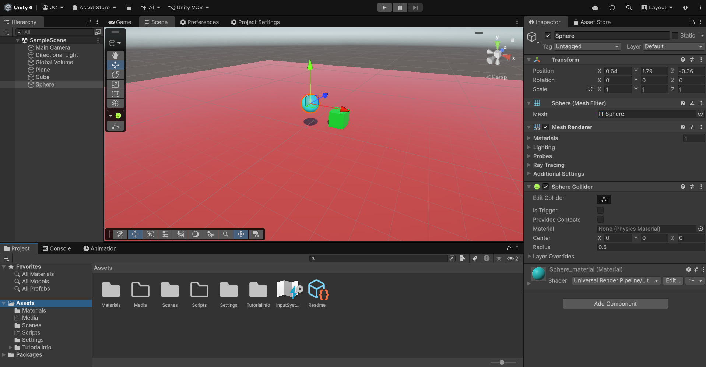
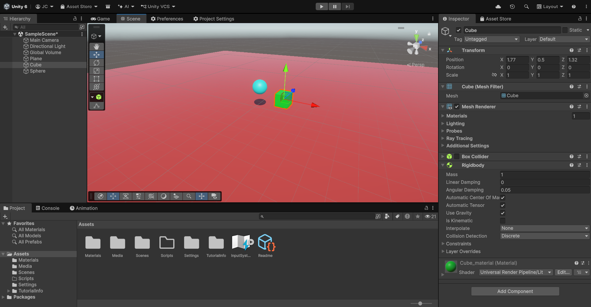

# Ejercicios 02: Físicas 3D
<sup> José Javier Ramos Carballo, [alu0101313313](https://github.com/alu0101313313)


## Indice

1. [Introducción](#1-introducción)
2. [Tareas a Realizar](#2-tareas-a-realizar)
3. [Desarrollo](#3-desarrollo)
4. [Conclusiones](#4-conclusiones)
5. [Bibliografía](#5-bibliografía)


## 1. Introducción
En esta práctica de la asignatura [Fundamentos del Desarrollo de Videojuegos](https://campusvirtual.ull.es/2627/doctoradoyposgrado/course/view.php?id=2627110295), nos encargaremos de realizar una serie de ejercicios relativos al funcionamiento de las fisicas en un proyecto 3D en Unity.

## 2. Tareas a Realizar

  - [ ] Ejercicio 1: Experimentar con diferentes configuraciones de los components Rigidbody y Collider y explicar los resultados obtenidos en base a lo explicado en clase.
  - [ ] Ejercicio 2: Crea un controlador con las teclas flecha arriba-abajo, derecha-izquierda que controle al cilindro con físicas
  - [ ] Ejercicio 3: Crea varios cubos o esferas con Rigidbody dinámico. Muestra por consola el nombre del objeto con el que colisiona, y cámbiale su color al colisionar.
  - [ ] Ejercicio 4: En la escena debe haber 3. Un cubo y un cilindro cinemáticos, una esfera con collider y Rigidbody. Marcar el cilindro como objetivo a alcanzar por la esfera. El cubo debe hacer de obstáculo entre ambos. Implementar un script que haga que la esfera se dirija al cilindro, cuando la esfera alcance el cubo, este debe cambiar su material y el cubo avanzar hacia adelante.

## 3. Desarrollo

Comenzamos colocando la escena tal cual como se nos pide en el guión de la práctica, ademas de añadir materiales a los diferentes elementos de la escena para su mejor identificación visual durante la realización de los ejercicios.



**_Ejercicio 1_**: Con la colocación principal, realiza las siguientes situaciones:

 1. Plano y Esfera con Collider, Cubo con Rigidbody

 

 En este caso, tanto el plano, la esfera y cubo contiene su respectivo _Collider_, no obstante, lo que decidi fue probar a añadirle el _Rigidbody_ al Cubo y desactivar el _Box Collider_, esto lo que hace es que el cubo tiene fisicas, y al ejecutar vemos como al no chocar con el collider del plano, este cubo cae infinitamente al vacío.

 Se puede solucionar si se añade que la opción de _IsKinematic_, lo que permite restringir que reciba empujes, gravedad u otras fuerzas que le puedan hacer interactuar.

 2. Plano con Collider, Cubo y Esfera con Rigidbody

 La situación es la misma que la anterior, salvo que con la esfera se actuara como se actuo con el cubo anteriormente. Al ejecutar se puede observar como la esfera tambien cae al vacio, lo cual tambien se puede arreglar activando la opción de _IsKinematic_

 

 3. Plano con Collide, Cubo y Esfera con Rigidbody, Esfera Cinemática

 Precisamente como comentabamos en las situaciones anteriores, si añadimos la opción _IsKinematic_, en este caso, la esfera tendra restringida las fuerzas que le afecten, lo que permite que este se quede flotando dado que ni la gravedad le afecta.

 

 4. Plano, Esfera y Cubo con RigidBody

 En este caso, sin activar la opción _IsKinematic_, se ve como los tres caen al vacío infinitamente.

 

 5. Plano, Esfera y Cubo con RigidBody, Esfera tiene 10 veces mas masa que el cubo.

 Para lograr esta situación, podemos ajustar la masa en el _RigidBody_, lo que al ejecutar, se puede visualizar como al principio parece que van a la misma velocidad, pero segun caiga, la esfera descendera mucho más rapido.

 6. Plano, Esfera y Cubo con RigidBody, Esfera tiene 100 veces mas masa que el cubo.

 Al igual que el caso anterior, lo que pasa es que el efecto se nota mucho mas rapido dado a que la velocidad incrementa debido a la masa de la esfera.

 7. Plano, Esfera y Cubo con RigidBody, Plano cinematico, Esfera es física con fricción.

 Con esto, nos aseguramos por un lado que el plano se queda quieto, y nos permite hacer de base para los otros dos objetos, por parte del cubo, como tiene rigidbody, le podemos aplicar fisicas, y este se quedara apoyado con fisicas en el suelo, mientras que con la esfera, estariamos añadiendo un material físico, que aplica una fricción en el momento de hacer contacto con el plano. Este valor de la fricción, se puede ajustar tanto como a cuanto mas baje, mas resbala, mientras que cuanto mas alto, menos rueda.

 

 8. Plano, Esfera y Cubo con RigidBody, Plano cinematico, Esfera no es física y tiene Trigger.

 En este caso, la idea es similar a la anterior, pero que en la esfera, desactivamos una opcion de _IsTrigger_, junto a que es cinematico. Esto lo que hace es que la esfera tiene fisicas, como es cinematico no le afectan las fuerzas, y como tiene el IsTrigger, podemos ver como ignora los triggers que hacen contacto con su _Collider_, lo que hace que si por ejemplo, usamos el cubo y lo movemos manualmente a la esfera, la esfera lo atraviesa.

 

 9. Plano, Esfera y Cubo con RigidBody, Plano cinematico, Esfera es física y tiene Trigger.

 Para este ultimo caso, la idea es que la esfera tenga activado el _IsTrigger_ pero que no sea cinematico. Esto implica que tiene las físicas, ademas de que como no es cinematico le afectan las fuerzas como la gravedad, caera por su masa, y luego este atravesará el plano dado a que como el _IsTrigger_ activo, ignorará las colisiones que tiene con otros elementos del mapa.

  - [x] Ejercicio 1: Experimentar con diferentes configuraciones de los components Rigidbody y Collider y explicar los resultados obtenidos en base a lo explicado en clase.

  **_Ejercicio 2_**: Crea un controlador con las teclas flecha arriba-abajo, derecha-izquierda que controle al cilindro con físicas

  ```C#

  using UnityEngine;

  [RequireComponent(typeof(CharacterController))]
  public class Cilinder_movement : MonoBehaviour
  {
    [SerializeField] float speed = 5f;

    [SerializeField] float gravity = -20f;
    [SerializeField] float rotationSpeed = 10f;

    CharacterController controller;
    Vector3 velocity;

    void Awake() => controller = GetComponent<CharacterController>();

    void Update()
    {
      float x = Input.GetAxisRaw("Horizontal");
      float z = Input.GetAxisRaw("Vertical");

      Vector3 move = new Vector3(x, 0, z).normalized;

      if (move.magnitude > 0.1f)
      {
        // Girar suavemente hacia la dirección de movimiento
        Quaternion targetRot = Quaternion.LookRotation(move);
        transform.rotation = Quaternion.Slerp(transform.rotation, targetRot, rotationSpeed * Time.deltaTime);
      }

      controller.Move(move * speed * Time.deltaTime);

      // Gravedad y salto
      if (controller.isGrounded && velocity.y < 0)
        velocity.y = -2f;

      if (Input.GetButtonDown("Jump") && controller.isGrounded)
        velocity.y = Mathf.Sqrt(jumpHeight * -2f * gravity);

      velocity.y += gravity * Time.deltaTime;
      controller.Move(velocity * Time.deltaTime);
    }
  }

  ```

## 4. Conclusiones
Gracias a esta práctica, podemos tener unas nociones esenciales de como funcionan los fundamentos de las fisicas en un proyecto de Unity.

## 5. Bibliografía
1. **Enunciado de la práctica:** [https://campusvirtual.ull.es/2627/doctoradoyposgrado/mod/assign/view.php?id=28155](https://campusvirtual.ull.es/2627/doctoradoyposgrado/mod/assign/view.php?id=28155)

2. **Guión de la práctica:** [https://docs.google.com/document/d/1lRqAT_1zM7fW50KubI1h8SxPrNA5vKGVkdX6U0nJbBU/edit?tab=t.0](https://docs.google.com/document/d/1lRqAT_1zM7fW50KubI1h8SxPrNA5vKGVkdX6U0nJbBU/edit?tab=t.0)