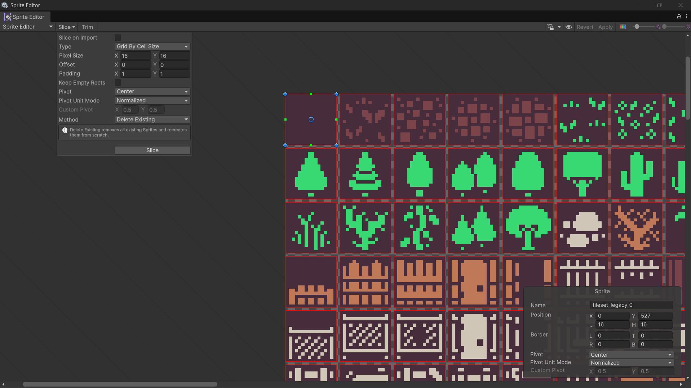
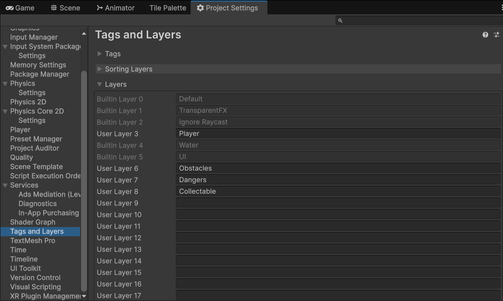
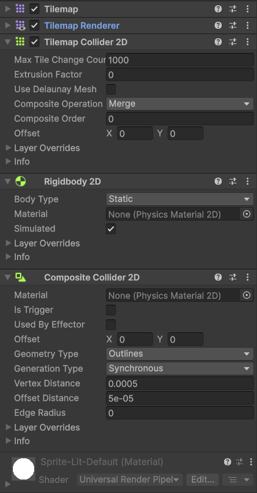
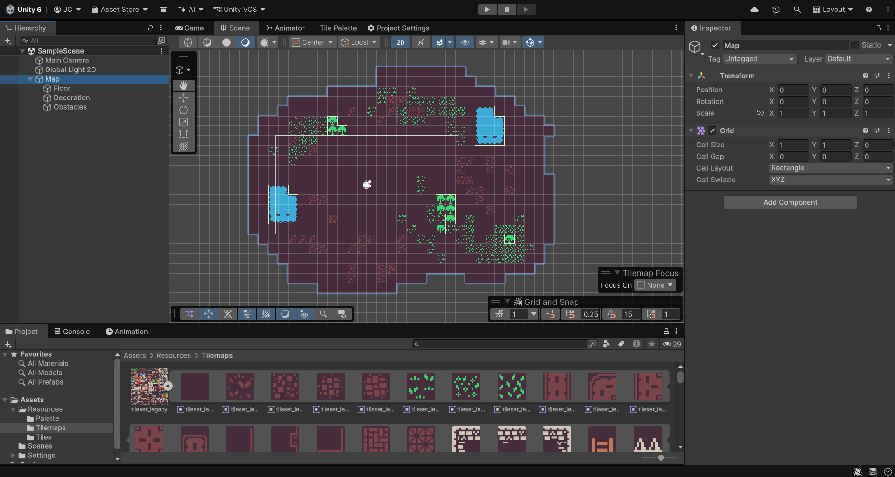
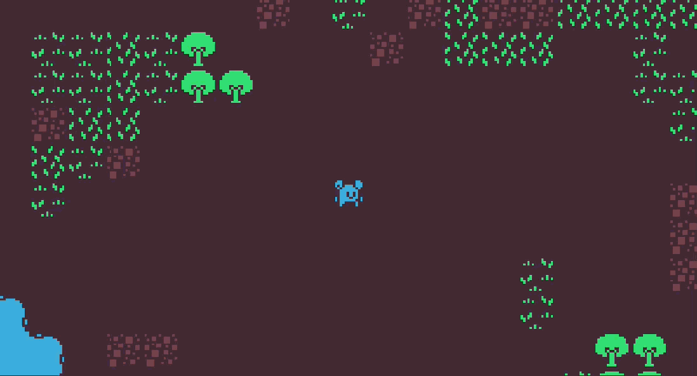
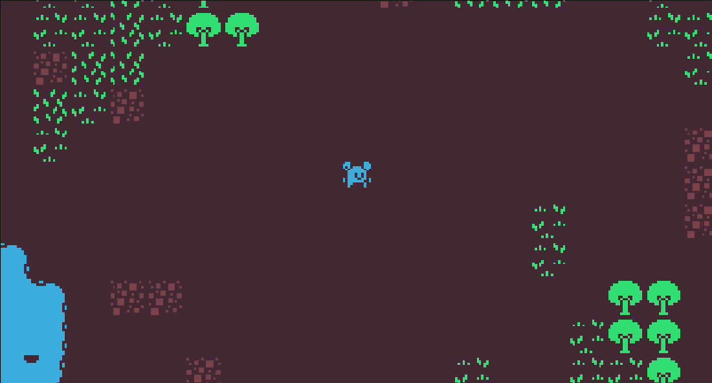
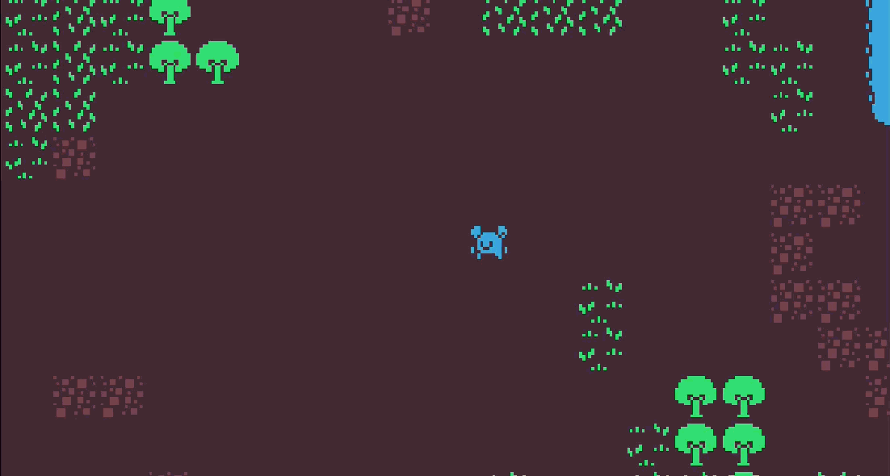
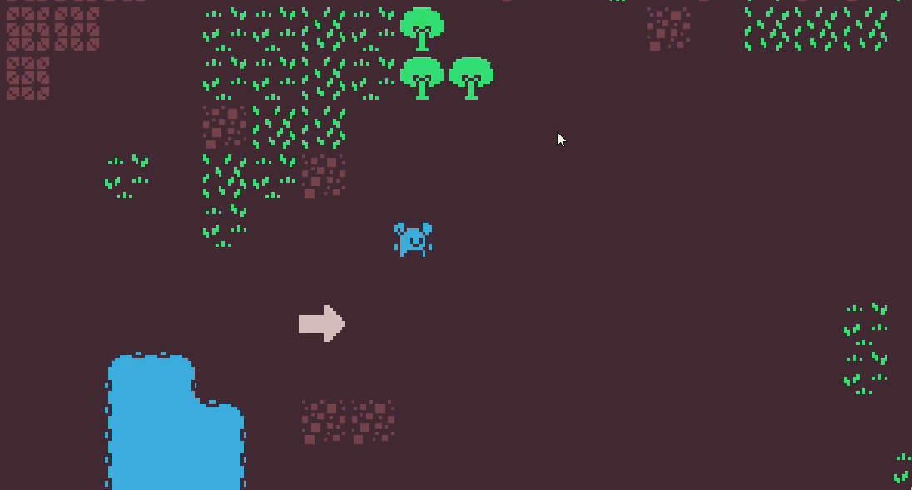

# Ejercicios 04: Mapas y Físicas 2D
<sup> José Javier Ramos Carballo, [alu0101313313](https://github.com/alu0101313313)


## Indice

1. [Introducción](#1-introducción)
2. [Tareas a Realizar](#2-tareas-a-realizar)
3. [Desarrollo](#3-desarrollo)
4. [Conclusiones](#4-conclusiones)
5. [Bibliografía](#5-bibliografía)


## 1. Introducción
En esta práctica de la asignatura [Fundamentos del Desarrollo de Videojuegos](https://campusvirtual.ull.es/2627/doctoradoyposgrado/course/view.php?id=2627110295), nos encargaremos de realizar una serie de ejercicios relativos a como funcionan las físicas y los elementos del mapa en un proyecto top-down 2D. 

## 2. Tareas a Realizar

  1. [ ] Realizar los diferentes ejercicios marcados en la [hoja de ejercicios](https://docs.google.com/document/d/1GAGr3BEjaPzPRIqmRj7BVKM9OEPDkvG43Wts8sLud3M/edit?tab=t.0)

## 3. Desarrollo

Para empezar, debemos tratar un tileset desde el cual, podemos escoger nuestras imagenes y/o materiales para los elementos visuales de nuestro videojuego.

Como aprendimos desde la práctica anterior, nos interesa tener un PPU acorde para que el tamaño de los tiles sea igual a la unidades de Unity, en nuestro caso configuramos el tileset con estas opciones, en las que destacamos, el _sprite mode_ en multiple, para poder tratar con cada tile en el corte, desactivamos los filtros y la compresión para que, el tileset de 1 bit se vea mas nítido.


Podemos ver en la siguiente imagen, el corte del tileset para tener un tilemap mas adecuado a nuestro juego, evitanto tener elementos vacios en los tiles, y cortando por tamaño de celda ajustado por el PPU anterior.



Gracias a esto, podemos crear los tile palettes, que son herramientas que como su nombre indica, son paletas de tiles que podemos utilizar para customizar nuestro mapa del juego. En este, podemos indicar diferentes tilemaps, para tener sus diferentes elementos de customización, como veremos mas adelante, tenemos tilemaps como fondos del mapa, mientras que otros de manera superpuesta van a tener diferentes características, como por ejemplo, el tilemap de obstaculos que lo utilizaremos para marcar zonas por las que nuestro personaje no puede pasar.


Precisamente el tener que tratar con diferentes tilemaps en un juego 2D señala la importancia de maquetar las diferentes capas del mapa del juego, para que estas se comprenetren bien tanto por la organización de los elementos del mapa, como de las diferentes interacciones que debene tener los actores del juego en el misma capa, por ejemplo, el personaje interactuando con elementos del mapa: enemigos, coleccionables, etc...



Concretamente es importante pararse con la capa de Obstaculos, dado a que ya no solo importa que esten colocados en la capa correcta para que el jugador interactue con ellos, sino porque tambien deben estan configurados para que funcionen como obstaculos.

Por ello tiene sentido que se añadan elementos commo el _RigidBody2D_ que forzamos a hacer de los obstaculos como elementos fijos con la opcion _Static_, y el tilemap collider 2D que con la opción de _Composite Operation: Merge_ nos permite unificar el compartmiento de todos los elementos de obstaculos. Precisamente con el Composite Colider 2D sobreescribimos el comportamiento de Tilemap Collider para especificar el comportamiento de manera especifica de estos elementos en grupo.



Tras manejar los diferentes elementos visuales relativos a los tilemaps, las capas visuales, y los elementos que seran interactuables en el mapa, podemos tener algo similar a la siguiente imagen, una vez hemos compuesto el mapa.



Desde el este punto, creamos al personaje jugable, el cual debia tener un movimiento sencillo para poder moverse por el mapa. En este caso de una videojuego top-down 2D, es importante señalar el movimiento en las 4 principales direcciones, ademas de eliminar elementos de gravedad, una detección de colisiones continua y la congelación en la rotación en el vector z (de profundidad), para su correcto funcionamiento.

En una primera instancia, el codigo del movimiento del personaje seria el siguiente:

```C#
using UnityEngine;

public class PlayerMovement : MonoBehaviour
{
	public float speed = 5f;
	private SpriteRenderer spriteRenderer;

	// Start is called once before the first execution of Update after the MonoBehaviour is created
	void Start()
	{
		spriteRenderer = GetComponent<SpriteRenderer>();
	}

	// Update is called once per frame
	void Update()
	{
		float horizontalUpdate = Input.GetAxis("Horizontal");
		float verticalUpdate = Input.GetAxis("Vertical");

		Vector3 direction = new Vector3(horizontalUpdate, verticalUpdate, 0f).normalized;
		transform.Translate(direction * speed * Time.deltaTime, Space.World);
	
		if (horizontalUpdate < 0) spriteRenderer.flipX = true;
		else if (horizontalUpdate > 0) spriteRenderer.flipX = false;
	}
}
```

Cabe destacar la declaración y posterior inicialización unica del _spriteRenderer_ que se utilizará para girar el sprite del personaje dependiendo de la dirección horizontal a la que nos dirigamos.

> [!NOTE]  
> Adicionalmente a la práctica, he decidido tambien incluir un código que nos permite que la camara este adherida al personaje, tal que cuando el personaje se mueva, la camara se siga, permitiendo acceder a mas mapa que esta contemplado fuera del alcance de la camara en su posición inicial. 


```C#
using System;
using UnityEngine;

public class CameraFollow : MonoBehaviour
{
  public Transform target;
  private float smoothSpeed = 5f;
  private Vector3 offset = new Vector3(0f, 0f, -10f);

  // Update is called once per frame
  void LateUpdate()
  {
    if (target == null) return;

    Vector3 wishedPosition = target.position + offset;

    float factor = Mathf.Clamp01(smoothSpeed * Time.deltaTime);
    transform.position = Vector3.Lerp(transform.position, wishedPosition, factor);
  }
}
```

Volviendo al movimiento del personaje, su ejecucción se ve de la siguente manera:



A partir del movimiento que tenemos, vamos a probar con diferentes tipos de movimientos en mapas 2D.

Probamos al adicción de un movimiento y rotación 2D donde el eje Z gire al personaje, no obstante este podia tener dos comportamientos princpiales en base a la referencia de la rotación.

Por un lado, tenemos el elemento _Space.Self_ lo que indica es que la rotación del eje Z se haga respecto al espacio local del personaje, esto lo que nos permite es que el personaje se mueva en dirección a la rotación local.


Por otro lado, tenemos el elementos _Space.World_ que a diferencia del anterior la rotación del eje Z se hace respecto al espacio del mundo del juego, lo que hace que el movimiento siga siendo ortogonal hacia arriba o abajo independientemente de la rotación que tenga nuestro personaje.



Ademas de los movimientos realizamos anteriormente, probamos un movimiento hechos con las físicas del motor, a través de asignar la velocidad del personaje al _RigidBody2D_ con el parametro _linearVelocity_.

Esto nos permite que las fisicas al tener funcionamiento, puedan interactruar con los obstaculos anteriormente configurados. El código utilizado para lograr este tipo de movimiento es el siguiente:

```C#
using UnityEngine;

public class PhysicMovement : MonoBehaviour
{
	public float speed = 5f;

	private Rigidbody2D rb;
	private SpriteRenderer spriteRenderer;
	private Vector2 input;
	
	void Start()
	{
		rb = GetComponent<Rigidbody2D>();
		spriteRenderer = GetComponent<SpriteRenderer>();
	}

	void Update()
	{
		float horizontal = Input.GetAxisRaw("Horizontal");
		float vertical = Input.GetAxisRaw("Vertical");
		input = new Vector2(horizontal, vertical).normalized;

		if(horizontal > 0) spriteRenderer.flipX = true;
		else if (horizontal < 0) spriteRenderer.flipX = false;
	}

	void FixedUpdate()
	{
		rb.linearVelocity = input * speed;
	}
}
```

Gracias a este comportamiento, efectivamente podemos comporbar como el movimiento responde al choque con los elementos marcados como obstaculos: en nuestro caso, ha ocurrido con los lagos, los arboles y los limites del mundo.



A partir de conseguir el movimiento hecho con físicas y la correcta interacción con los elementos del mapa, otro punto de la práctica que se nos pide meter interacción es con un elemento que fuerze el movimiento, como una "lanzadera" que desplaze al personaje.

Para ello, creamos un elementos en el mapa que utilizaremos como lanzadera, y le asignamos un código que le permite funcionar cuando entre en el trigger de la zona con el personaje, forzando un desplazamiento, en nuestro caso hacia la izquierda del mapa.



Otro requisito de la practica consiste en añadir elementos coleccionables que sumen puntos, y amenazas que resten puntos a un total del personaje.

La forma en la que se trabajo en este punto fue a partir de una clase statica llamada _Score_, esta clase contiene el elementos _Up()_ y el elemento _Down()_ que respectivamente suman y restan puntos a un total de puntos. La gracia de hacer tanto la clase como los metodos estaticos y publicos, nos permite que cualquier elementos del codigo pueda interactuar con ellos, lo que nos da pie a hacer elementos tantos que al ganar o perder puntos podamos llamar a estos metodos que nos permite unificar el marcador con todos los elementos que lo llamen.

Luego esta la implementación tanto de las monedas como coleccionables que suman puntos y los enemigos que al tocarlos nos hagan perder puntos, los cuales se incluyeron de manera similar, exceptuando que con las monedas cuando las recogiamos las destruiamos, para dar la sensación de colección.


Finalmente para finalizar tenemos el enemigo que nos persigue con su mascota la cual nos hace daño.

Para empezar hicimos un enemigo que tuviese entre sus elementos el transform de nuestro player de forma que su movimiento se basará en alcanzar en todo momento nuestra posición, mientras que la mascota lo que hará sera perseguir a su dueño, de forma que cuando este cerca del personaje, este se mueva para hacer daño a nuestro personaje.

Una muestra final de como quedaria esta implementación con el resto del juego se ve de la siguiente manera.


## 4. Conclusiones
Gracias a esta práctica, podemos tener unas nociones esenciales de como manejar los mapas y las físicas en un proyecto top-down en 2D.

Hemos podido comprobar como funcionan el sistema de paletas, los tiles, y los ordenes de capas en un proyecto sin capa de profundidad para que tengan su orden correcto y diferentes interacciones.

Por otro lado tambien se ha tratado con los difernetes movimientos que nos permite tener físicas, los movimientos respecto al espacio local o el espacio del mundo, las interacciones con elementos de obstaculos, elementos coleccionables y diferentes tipos de amenazas, tanto estaticas como dinámicas.

## 5. Bibliografía
1. **Enunciado de la práctica:** [https://campusvirtual.ull.es/2627/doctoradoyposgrado/mod/assign/view.php?id=23549](https://campusvirtual.ull.es/2627/doctoradoyposgrado/mod/assign/view.php?id=23549)

2. **Guión de la práctica:** [https://docs.google.com/document/d/1GAGr3BEjaPzPRIqmRj7BVKM9OEPDkvG43Wts8sLud3M/edit?tab=t.0](https://docs.google.com/document/d/1GAGr3BEjaPzPRIqmRj7BVKM9OEPDkvG43Wts8sLud3M/edit?tab=t.0)

3. **Transparencias Tilemaps** [https://docs.google.com/presentation/d/13BMyK7HzjSruZ2P4BJyQcC1LBgEGQAZowfBC3Y2YpiM/edit?slide=id.g641b2b7d36_0_7#slide=id.g641b2b7d36_0_7](https://docs.google.com/presentation/d/13BMyK7HzjSruZ2P4BJyQcC1LBgEGQAZowfBC3Y2YpiM/edit?slide=id.g641b2b7d36_0_7#slide=id.g641b2b7d36_0_7)

4. **Transparencias Físicas 2D** [https://docs.google.com/presentation/d/1RRqh8da1yAzypotoP2g5dd6aAKYt-CWuw3FOuaF5ywc/edit?slide=id.g616d7d7459_0_516#slide=id.g616d7d7459_0_516](https://docs.google.com/presentation/d/1RRqh8da1yAzypotoP2g5dd6aAKYt-CWuw3FOuaF5ywc/edit?slide=id.g616d7d7459_0_516#slide=id.g616d7d7459_0_516)

